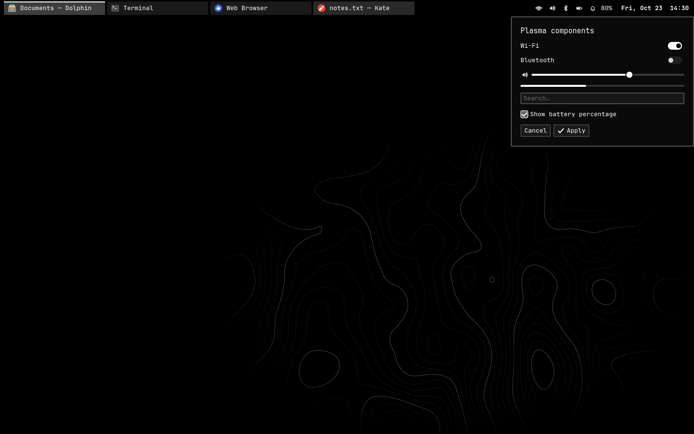
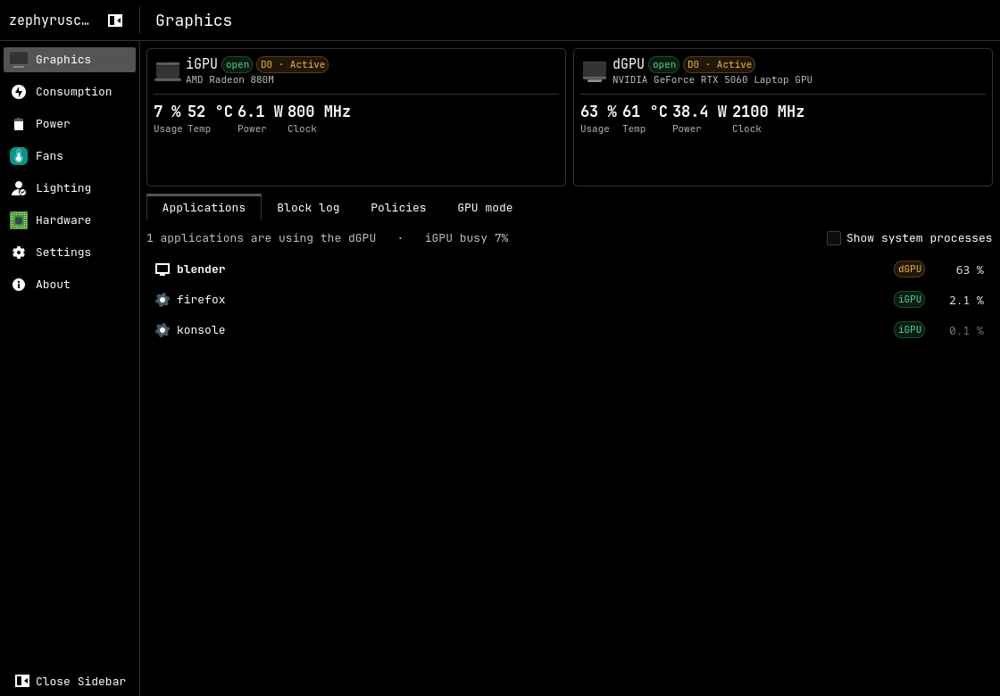

# Arch Linux on the ROG Zephyrus G14 (GA403)

My Arch Linux setup for the ASUS ROG Zephyrus G14 (2025, GA403GM): a full install
guide from a blank archiso (no `archinstall`), the system and user configuration,
the patches and custom packages, and the reasoning behind each choice.



> **A note before you start:** this setup was originally built for my own laptop and
> daily use, and is shared in case it helps other G14 owners. It reflects my own
> hardware, tools and preferences, so it may not fit every system or workflow. Read
> each section before applying it. Issues and suggestions are welcome.

## The system in short

| | |
| --- | --- |
| Hardware | ROG Zephyrus G14 GA403GM: Ryzen AI 9 465 + Radeon 880M, RTX 5060 Laptop, 2880x1800 120 Hz OLED |
| Disk | GPT, 1 GiB ESP + LUKS2 (argon2id), btrfs subvolumes `@ @home @pkg @log @swap`, zram + swapfile |
| Boot | Unified Kernel Image started directly by the firmware (no boot loader), Secure Boot with own keys, TPM2 auto-unlock (PCR 7), optional fallback GRUB |
| Repos | Arch + CachyOS x86-64-v4 |
| Kernel | `linux-lapidary`: CachyOS kernel with a few G14 patches, plus stock `linux` as a fallback |
| Desktop | KDE Plasma 6 (Wayland), SDDM, PipeWire, Iris theme family |
| Power | asusd (80% charge limit), supergfxctl (dGPU off in D3cold), power-profiles-daemon, Panel Replay, KWin overlay planes / direct scanout |
| Shell | fish, Konsole, micro |

## Guide

Follow the documents in order. Each change is described with **what** it is,
**why** it is done that way, **how** to apply it, how to **verify** it and how to
**revert** it.

1. [Base installation](docs/01-base-install.md): from the archiso to an encrypted,
   Secure Boot enabled system booting a UKI.
2. [Desktop](docs/02-desktop.md): KDE Plasma, SDDM, audio, Bluetooth, NVIDIA
   driver, snapshots, enabled services.
3. [G14 hardware and power](docs/03-g14-hardware-and-power.md): asusd, GPU
   switching, power profiles, display (Panel Replay, VRR, overlay planes, HDR
   EDID), the ALC285 audio fix, suspend, measured numbers, and what was tried and
   dropped.
4. [Custom packages](docs/04-custom-packages.md): the patched kernel, Plymouth and
   KWin packages, every patch explained, and how to go back to the stock packages.
5. [Dotfiles and desktop](docs/05-dotfiles-and-desktop.md): fish, Konsole, KDE
   settings, rofi, user services and helper scripts.

Parts that only apply to the tested model are marked **[GA403GM]** in the
documents. Other GA403 variants share most of the platform, but check PCI
addresses, codec IDs and the panel before copying model-specific files.

## Repository layout

| Path | Contents |
| --- | --- |
| [`docs/`](docs) | the guide |
| [`system/`](system) | system files at their real target path (`system/etc/...` goes to `/etc/...`) |
| [`home/`](home) | user files at their path under `$HOME` |
| [`packages/`](packages) | package lists and PKGBUILDs + patches of the custom packages |
| [`scripts/`](scripts) | `apply-dotfiles.sh` and `apply-kde-settings.sh` |

## Installation

There is no single installer on purpose: most of this touches the boot chain,
disk encryption and drivers, and should be done step by step.

```sh
git clone https://github.com/lckt0/zephyrus-g14-arch.git
cd zephyrus-g14-arch
```

- **New install:** follow [docs/01](docs/01-base-install.md) to
  [docs/05](docs/05-dotfiles-and-desktop.md) in order.
- **Existing Arch install:** read [docs/03](docs/03-g14-hardware-and-power.md) and
  copy only the system files you want from `system/` (each one is explained there),
  then apply the user files:

```sh
scripts/apply-dotfiles.sh --dry-run    # see what would change
scripts/apply-dotfiles.sh              # copy home/ into $HOME, backing up existing files
scripts/apply-kde-settings.sh          # write the KDE settings (fonts, effects, power, ...)
```

`apply-dotfiles.sh` only writes inside `$HOME`. Files it replaces are kept under
`~/.local/state/g14-dotfiles/backup-<timestamp>/`.

## Uninstallation

- **User files:** undo a run of the dotfiles script with its backup directory:

  ```sh
  scripts/apply-dotfiles.sh --restore ~/.local/state/g14-dotfiles/backup-<timestamp>
  ```

  KDE settings written by `apply-kde-settings.sh` can be reset from System Settings,
  or by removing the listed keys (see [docs/05](docs/05-dotfiles-and-desktop.md),
  section 2).
- **System files:** remove the copied file and undo its effect as described next
  to it in [docs/03](docs/03-g14-hardware-and-power.md) (for example rebuilding
  the initramfs or reloading udev rules).
- **Custom packages:** [docs/04](docs/04-custom-packages.md) explains how to go back
  to the stock `linux`, `plymouth` and `kwin` packages.

## Related projects

- [iris-desktop](https://github.com/lckt0/iris-desktop), [iris-greeter](https://github.com/lckt0/iris-greeter), [iris-volume](https://github.com/lckt0/iris-volume): the black Plasma theme, login screen and volume applet used here
- [zephyrusctl](https://github.com/lckt0/zephyrusctl): a control panel for the G14 (fans, LEDs, power, GPU)
- [arch-update-gui](https://github.com/lckt0/arch-update-gui): update popup for the tray
- [harfiyen](https://github.com/lckt0/harfiyen): touch typing trainer



## License

The documentation, configuration files and scripts are released under the
[MIT License](LICENSE). Patches and PKGBUILDs under `packages/` are derived from
their upstream projects (Linux, CachyOS, Plymouth, KWin) and stay under those
projects' licenses.
